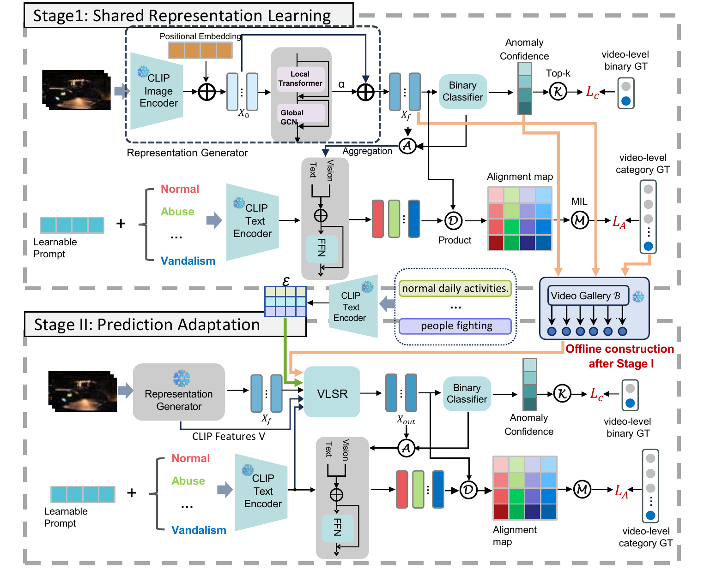

# ARC-VAD

PyTorch implementation of ARC-VAD for fine-grained weakly supervised video anomaly detection.



[Framework PDF](assets/framework.pdf)

## Environment

Python 3.10+, PyTorch 2.3.0, and CUDA 12.1.

```bash
pip install -r requirements.txt
```

CLIP ViT-B/16 weights are downloaded automatically on first use.

## Data Preparation

Download the pre-extracted CLIP features for XD-Violence and UCF-Crime from [VadCLIP](https://github.com/nwpu-zxr/VadCLIP), then prepare the data lists with your local feature paths:

```bash
python prepare_data.py --dataset xd --train-root /path/to/XDTrainClipFeatures --test-root /path/to/XDTestClipFeatures
python prepare_data.py --dataset ucf --train-root /path/to/UCFTrainClipFeatures --test-root /path/to/UCFTestClipFeatures
```

Dataset configurations are provided in `configs/xd.json` and `configs/ucf.json`.

## Training

Run commands from the repository root. For XD-Violence, train Stage I, build the reference gallery, and train Stage II:

```bash
python src/main.py train --config configs/xd.json --stage 1 --output runs/xd/stage1
python src/main.py build-references --config configs/xd.json --checkpoint runs/xd/stage1/best.pt --output runs/xd/references.pt
python src/main.py train --config configs/xd.json --stage 2 --checkpoint runs/xd/stage1/best.pt --references runs/xd/references.pt --output runs/xd/stage2
```

For UCF-Crime, replace `configs/xd.json` and `runs/xd` with `configs/ucf.json` and `runs/ucf`.

## Testing

Use the trained Stage-II checkpoint and its corresponding reference gallery.

XD-Violence:

```bash
python src/main.py evaluate --config configs/xd.json --stage 2 --checkpoint runs/xd/stage2/best.pt --references runs/xd/references.pt
```

UCF-Crime:

```bash
python src/main.py evaluate --config configs/ucf.json --stage 2 --checkpoint runs/ucf/stage2/best.pt --references runs/ucf/references.pt
```

## Acknowledgments

We thank [VadCLIP](https://github.com/nwpu-zxr/VadCLIP), [CLIP](https://github.com/openai/CLIP), and [DSANet](https://github.com/lessiYin/DSANet) for their open-source implementations. See [THIRD_PARTY_NOTICES.md](THIRD_PARTY_NOTICES.md) for attribution and licenses.
